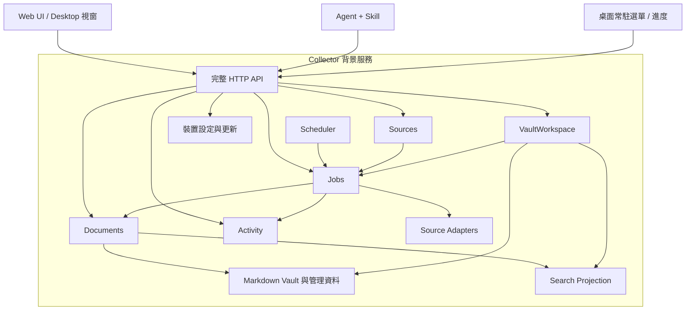

# Round 2 開發計畫與進度

本文件是 XR Collector 當前開發指引，定義本輪產品目標、已確認行為與 ticket 分工。[產品範圍](product-brief.md) 說明定位與排除項目，[README](../README.md) 說明可執行版本的使用方式；第一輪計畫僅作 [歷史紀錄](history/mvp-plan.md)。

## 目前進度

核對日期：2026-09-21。已合併程式基準為 `b711d65`（PR #38）；ticket 狀態以 [GitHub 總覽 #24](https://github.com/derektu/xr-collector/issues/24) 與各票的驗收證據為準。這裡記錄交付進度，不以規劃文件存在或測試成功推定新功能完成。

| 範圍 | 已具備的能力 | 待交付 |
| --- | --- | --- |
| 收集與文件 | YouTube 單支／頻道收集、基本排程、搜尋與閱讀 | 新介面、Global 訂閱政策、文件刪除 |
| 工作與服務 | 目前程序內的批次工作與排程 | 非同步持久工作、接續與重試、活動記錄、桌面常駐 |
| Agent | 只讀 HTTP API、每次啟動的連線檔 | 完整業務操作與受控的本機連線資料 |
| Vault | Markdown 保存、完整匯出／還原／比對合併 | Onboarding、選址、安全搬移及新資料契約整合 |
| 驗證與交付 | #25 已關閉：CI、獨立原生驗證；Mac arm64／Windows x64 打包入口已可用 | 兩平台本機正式候選包、完整安裝驗收、Release 與更新 |

本輪 20 張執行票中，#25 已關閉，其餘 19 張仍開啟；#24 是總覽，不計為執行票。第一輪 #3–#9 的功能是本輪擴充與遷移的基礎，既有資料與必要行為仍須保持相容。

## 如何使用本計畫

- **產品需求**：第 1、3、7 節與第 6 節各票範圍是本輪開發依據。第一輪歷史與早期研究不覆蓋本輪已確認決策。
- **設計參考**：[UI Design Spec](ui-design/README.md) 與六份 HTML wireframe 用於視覺討論，各功能票的設計討論見第 2 節；它們不代表產品已實作。
- **實作提案**：第 4 節記錄程式檢視基準，第 5 節的模組、欄位及 API 形狀供實作時收斂，不是要求照抄的最終設計。
- **執行與驗收**：依第 6 節的依賴選票，開工前在對應 issue 批准細部 scenario；完成後更新該票的證據與狀態。票與本計畫有需求衝突時先釐清，不能自行降低驗收標準。

建議下一步先確認 #23 的設計基準；#22 服務 runtime 可依契約獨立推進，#19 App Shell 與各功能票依第 6 節銜接。交付鏈依 #139 engine → #34 本機封裝 → #35 publisher → #36 updater → 首版四包與公開發布推進；#34 不必等全部 UI 完成。這是依賴順序建議，不表示這些票已開始或已完成。

## 1. 第二輪的產品成果

使用者能完成「選擇自己的知識庫 → 設定來源 → 持續收集 → 找到與閱讀文件 → 移除不要的內容 → 查明失敗原因 → 備份或搬移」的完整流程。Agent 能透過完整 HTTP API 收集內容、管理訂閱與設定、操作文件及 Vault，並查詢工作與活動記錄。UI 與 Agent 是同一個 Collector 服務的操作入口；產品以可獨立運作的背景服務為架構方向。

第一個實際來源維持 YouTube。產品導覽、文件管理、背景工作及記錄採來源中立的結構，讓 RSS、網頁與 XQ 的接入有明確位置。第二輪不以交付所有來源為完成條件，也不納入完整 XR 的 Evidence／Claims 生成、正文編輯、草稿審核或垃圾桶。

這輪包含以下互相影響的工作：

| 工作 | 對應需求 | 主要成果 |
|---|---|---|
| 產品介面與完整操作流程 | #23、#19、#26 | 六個畫面、共用導覽、狀態與錯誤恢復 |
| 背景工作與可追查記錄 | #18、#27、#28、#29 | 非同步收集、進度、持久記錄、Agent 操作及查詢 |
| 文件管理 | #26、#17 | 篩選、閱讀、刪除、避免自動重新收集 |
| Vault 位置管理與資料交換 | #20、#30、#31 | 新建／開啟既有 Vault、安全搬移、失敗恢復 |
| 完整 Agent 入口與服務生命週期 | #22、#21 | 所有業務 API 可由 Agent 操作，核心服務不依賴 UI |
| 桌面常駐入口 | #32、#33 | 關閉視窗後縮至常駐入口，顯示進度並可重新開啟 UI |
| CI、Release 與更新 | #25、#34、#35、#36、#10 | 自動驗證、產出版本及安裝包、自動檢查新版本 |

## 2. 畫面基準與各功能票的設計責任

#23 確認主要頁面各自的用途、共用導覽、配色與基本版型。現有六張 HTML wireframe 是後續開發的起點；完成條件是已有足夠讓各功能票開始的畫面基準。

各功能票開工時，連同功能範圍一起確認操作方式、待釐清問題與驗收計畫，並補上該次實作需要的畫面。#23 不要求預先回答所有問題或畫完所有狀態。開發中有新的設計決定時，由該功能票同步更新相關 mockup 與說明；涉及其他功能或已確認產品需求時，同步相關票與本計畫，不必重新開啟 #23。

| 畫面／項目 | 負責票 | 開工時討論的內容 |
|---|---|---|
| 共用導覽與外觀 | #19 | 收集來源、文件、設定、活動記錄四個入口；深淺色與最小視窗的呈現 |
| 首次設定與重新選擇目錄 | #20 | 建立或開啟知識庫、目錄檢查及無法開啟時的處理。設計方向為先選目錄，再以單一按鈕顯示「建立知識庫」或「開啟知識庫」，具體行為在本票確認 |
| 收集來源與訂閱 | #19、#27、#52、#53 | URL 辨識後的操作、訂閱說明、每個來源的收集設定與自動收集總開關，以及暫停／恢復／移除訂閱 |
| 收集進度與活動記錄 | #18、#28、#29 | 如何查看目前工作、切頁後回到工作、理解失敗原因及重試結果 |
| 文件、搜尋與閱讀 | #26 | 依頻道篩選、搜尋結果、日期標示、返回位置、Markdown 排版，以及沒有資料或搜尋不可用時的呈現 |
| 刪除文件 | #17 | 確認內容、處理中與結果，以及從閱讀頁刪除後的去向 |
| 匯出、還原與合併 | #30 | 合併至目前知識庫與還原為另一份知識庫的入口、差異選擇、進度與結果 |
| 搬移知識庫 | #31 | 目標位置、搬移中可做的操作、完成或失敗的提示 |
| 桌面常駐與登入自啟 | #32、#33 | 常駐選單、進度、開啟視窗、明確退出及登入自啟開關 |
| 版本與更新 | #36 | 檢查更新、發現新版、下載／安裝及失敗時的畫面 |

搜尋與文件列表在同一頁。來源篩選要能分辨「YouTube 這類來源」與「某個頻道」；選單如何排列由 #26 確認。停止訂閱後，已有文件仍可按原頻道篩選。

## 3. 使用者流程與實作約束

### 3.1 第一次啟動與再次啟動

1. 未設定 Vault 時顯示 Onboarding，提供預設目錄、新建及開啟既有 Vault。
2. 檢查路徑、權限、正式檔案可讀性與格式。既有目錄無效時留在此流程，不直接建立空白庫覆蓋使用者期待的資料。
3. 成功後保存裝置上的選擇；新 Vault 進入收集來源，已有文件的 Vault 可進入文件頁。
4. 再次啟動讀取已選路徑。路徑遺失、同步檔案未下載或無法讀取時提供重試與重新定位；不默默改用預設空庫。

搜尋引擎啟動失敗應顯示可恢復的搜尋狀態；正式資料可讀時仍能瀏覽與閱讀。既有安裝升級時接續目前 Vault，不讓使用者誤以為資料消失。

### 3.2 單支收集

`輸入 URL → 驗證 → 工作已接受 → 排隊／解析／擷取 → 文件已保存 → 索引更新 → 開啟文件`

- URL 語法錯誤立即顯示；需要外部存取的解析交由背景工作。
- 工作建立後可切換頁面、搜尋或提交其他工作；回到來源頁仍看得到執行狀態。
- 已存在時開啟既有文件；同一影片執行中時連到同一工作，不產生並行下載。
- 文件保存與索引完成分別表達。索引失敗時顯示「文件已保存，搜尋更新失敗」，提供查記錄／重試索引，不要求重新下載。
- 暫時性錯誤（例如網路中斷）自動重試，設次數上限；無字幕、影片已刪除等記錄原因，不持續重試。不自動啟用語音轉寫。重試耗盡後在工作結果提供失敗原因。

### 3.3 訂閱與排程

單一 URL 輸入入口依格式判斷：影片 URL 顯示「收集影片」；頻道 URL／@handle 顯示「訂閱頻道」。無法辨識時顯示原因，不直接執行。訂閱前的頻道預覽是一次有逾時上限的同步查詢，讓確認卡能立即顯示頻道名稱與訂閱摘要；收集本身一律交由背景工作。

純播放清單 URL 本輪不支援；同時含影片與播放清單識別的觀看 URL 按單支影片處理。播放清單保留為後續方向，可分為一次批次收集與持續訂閱，具體契約另定。

`輸入頻道 → 解析並顯示頻道、收集設定與摘要 → 確認訂閱 → 立即首次收集 → 持續檢查新內容`

每個訂閱有自己的收集設定，欄位與選項由來源類型宣告。新訂閱預設每 **30 分鐘**檢查一次；每次檢查收集**最近 1 個月內最新的 10 則**中尚未收集、未刪除的內容。確認卡可在訂閱前調整，訂閱後在來源詳情修改並立即儲存；來源詳情可把一組設定套用到所有同類來源。自動收集總開關在來源頁標題列。

訂閱摘要範例：「訂閱後立即檢查，之後每 30 分鐘檢查一次；每次檢查收集最近 1 個月內最新的 10 支影片，已收集或刪除的不再收集。」數值反映確認卡上的設定。按下訂閱即開始首次收集並啟用持續追蹤，不需要另外開啟排程。

每次檢查都用同一條規則，不分首次訂閱、定時檢查、立即檢查、暫停後恢復、服務重新啟動、長時間未檢查、中斷接續或上次檢查失敗之後（#70）：

1. 以檢查開始探索的時間為基準算出時間範圍，例如往前 1 個月。
2. 範圍內最新的 N 則（N 為數量上限，直播預告不算）是候選。
3. 候選中已收集、已刪除的內容不收，其餘收集；不往更早的內容找替代品補足 N 則。

- 修改檢查頻率只影響該訂閱，從它上次派工時間重新計算下一次檢查；修改時間範圍或數量上限，從之後開始探索的檢查生效，不主動重新檢查。已列出影片的工作中斷後照原本的影片接續，略過已保存項目。
- 範圍外或超出上限的影片可以用單支 URL 手動加入，不受收集範圍限制。
- 每個頻道可暫停或恢復；移除訂閱保留已收集文件，只停止後續自動收集。暫停／移除與執行中項目的收斂時機於 #27 定義，並由 #28 驗證重啟接續，不讓失效訂閱在重啟後被自動重新啟用。
- 顯示上次偵測／派工時間、當前工作、最近完成結果，避免把「已派工」寫成「收集完成」。
- 大頻道不能長時間占滿所有派工機會；手動另一頻道應有自己的工作及結果。
- Collector 服務停止／電腦休眠時不保證排程執行，不補跑每一個漏過週期。休眠恢復後的檢查同樣依上述規則，從檢查當下往前算範圍。

排程按各訂閱自己的頻率檢查，同時到期的訂閱一起派工；scheduler 派工後不等待整批下載完成。同來源尚未完成時避免並行重複擷取，但不得因合併派工漏掉持續運作期間的新內容。到期計算、發現游標及重啟恢復以共同契約測試，不能只保存一個最後執行時間而遺失尚未處理的項目。

### 3.4 瀏覽、搜尋、閱讀與刪除

- 空庫提供「開始收集」入口；沒有搜尋結果與無法搜尋分開呈現。
- 無查詢字串時，列表與來源篩選直接由 Vault 文件資料提供，不依賴搜尋引擎就緒。
- 有查詢字串時顯示命中片段、結果總數與分頁；返回列表保留查詢、來源、頁碼與捲動位置。
- Reader 使用 720px 閱讀寬度、16px／1.8 行高及 64px 收合 Sidebar；小視窗可縮減側距。未知發布日期明示未知，收集日期另有標籤。
- 刪除需確認。成功後列表、Reader、來源文件數及後續 UI／Agent 查詢一致；索引未修復時不得繼續回傳該文件的陳舊搜尋片段。
- 刪除紀錄以來源穩定識別保存於 Vault。後續頻道手動批次抓取及排程都略過；使用者明確以單支 URL 重新收集才解除略過狀態，且需待重新保存成功後生效。
- 刪除與執行中收集同一項目時，由文件寫入流程重新檢查刪除紀錄，避免較早建立的工作將內容復活。
- 匯入包缺少文件不表示刪除。包內的刪除紀錄與本機的文件以時間較新者為準，刪除紀錄永久保留；規則見 #77。

### 3.5 查問題與 Agent 存取

`來源／文件上的結果 → 查看此次工作 → 時序記錄與錯誤 → 複製診斷資訊／重試`

活動頁保留三欄 log 表，另提供目前工作摘要、時間／等級／工作篩選及載入更多。工作進度在發現總數之前顯示「解析中／已發現 N 筆」，不虛構百分比；發現完成才使用確定總數。

Agent 使用與 UI 相同的完整 HTTP API，包括單支收集、訂閱新增／修改／移除、各訂閱的收集設定與自動收集開關、文件查詢／刪除、索引重建、Vault 選址／搬移／匯出／還原／合併，以及工作與活動記錄查詢。操作契約與結果相同，不以 Agent 入口限制為唯讀，也不直接修改 Vault 檔案。

典型流程：「訂閱這個頻道」→ Agent 呼叫訂閱 API → 回報已接受與首次收集範圍 → 服務在背景執行 → Agent 查詢結果；UI 開啟時看到相同訂閱、文件與工作。Agent 不必保持連線等待下載，UI 也不必開著。

Skill 說明所有已交付的 API、參數、工作生命週期及錯誤處理，供 Agent 查問題或完成操作。#22 的 Agent 寫入能力納入本輪各功能的完成條件。使用者從首次 Onboarding 或設定頁下載通用 Skill 與當下的連線資料；下載包已包含連線設定，因此不必在每個 Agent session 重新從 UI 複製。沿用 HTTP，不以新增 MCP 為前提。

### 3.6 Vault 搬移、匯出與匯入

`選擇目標 → 驗證 → 暫停新寫入並等待現有寫入結束 → 複製 → 完整性檢查 → 準備新執行環境 → 保存選址 → 切換 → 清理原位置 → 接續工作 → 呈現結果`

- 目標不可位於來源內部，也不可默默覆蓋其他 Vault；處理同一路徑、符號連結、不可寫與空間不足。
- 搬移複製完整正式資料，包含訂閱、排程設定、刪除紀錄；索引、log、工作執行資料、連線憑證留在裝置目錄。
- 切換前失敗保留原 Vault 與原選址。使用可恢復的操作紀錄處理切換前後中斷；切換後不能在不知情下退回另一份可寫副本。
- 驗證完整且切換成功後，自動清除原位置的 Vault 資料；切換前失敗保留原資料。若切換成功但清理失敗，保留新 Vault 為 active，明示舊資料尚待清理，不將部分清理的原位置重新視為可用 Vault。
- 搬移前停止接受新收集工作與派送排隊工作，只等待目前執行中的項目完成，不必等待整個批次。排隊工作持久保留，搬移成功後接續；搬移失敗且原 Vault 可用時在原位置恢復。其他寫入入口同樣受搬移鎖管理。
- 搬移期間 UI 清楚說明暫停原因；可讀舊資料時仍提供瀏覽。工作狀態及 log 查詢持續可用。
- 合併沿用預覽、逐項選擇、變更檢查與失敗恢復；還原另建 Vault，預設暫停自動收集，畫面明示並提供恢復入口；此行為只用於匯入還原，不改變新訂閱立即開始的規則。兩者不共用含糊的「匯入成功」結果。

## 4. 程式架構檢視

本節是 2026-09-19、commit `ca50294` 的程式檢視基準，用於解釋第二輪改動的原因；行號及未完成項目須在各票開工時對照當前程式。當前交付進度見本文開頭，現行模組說明見 [架構](architecture.md)。

| 位置 | 現況 | 對第二輪的影響與建議 |
|---|---|---|
| `src/core/collector.ts` | `collect()` 直接解析 YouTube URL，接收 `YouTubeCapture`；已有影片 in-flight 去重 | 保留去重概念；來源解析移至 YouTube adapter，保存／索引流程由共用模組負責 |
| `src/core/types.ts`、`src/vault/markdown-vault.ts` | `SavedDocument` 固定 Transcript，必填字幕／頻道欄位；只讀寫 `documents/youtube` 與 YouTube ID | 文章來源無法自然接入；共用文件欄位與來源專屬 metadata 分開，既有 ID／檔案相容 |
| `src/channels/channel-collector.ts:86` | 只要有 active run，任何 `startRun(channelIds)` 都回傳它，沒有比對要求的頻道範圍 | A 執行中要求 B 會取得 A 的工作，B 不一定被加入；#18 需依來源／項目去重，不以全域單一批次代替所有要求 |
| `src/channels/channel-collector.ts` | runs 是記憶體 Map；頻道與影片逐筆等待；回溯上限為建構參數 | 重啟無工作歷史；不能直接支援 UI 的可調回溯與公平派工 |
| `src/channels/channel-scheduler.ts:129` | `runDueSchedule()` 持有 checking 並輪詢等待整批結束 | Node event loop 並非被同步阻塞，但 scheduler 的該輪工作生命週期被整批占用；需分開派工與完成追蹤 |
| `src/server/app.ts:228`、`:216` | 單支收集、頻道加入及重建索引等待完成；頻道批次已有 202 入口 | 統一長工作接受／查詢契約，勿以單一 HTTP 連線承載全程 |
| `src/server/app.ts:60`、`src/server/agent-access.ts` | Fastify logger 關閉；零散 console 訊息；Agent 只允許既有文件／搜尋 GET | 缺少持久業務記錄；需要結構化 log，並將 Agent 入口接到完整業務 API；既有 GET allowlist 不符合本輪目標 |
| `src/search/meilisearch-backend.ts:214` | 索引 key 用 sourceId，頻道篩選用名稱；無單文件刪除介面 | 不同來源可能 ID 相撞，同名頻道混在一起；key 應由完整文件身分穩定編碼，篩選用穩定來源 ID |
| `src/search/managed-transcript-search.ts:42` | 啟動時只比文件數，數量相同即不重建；更新期間搜尋拒絕服務 | 相同數量但內容／身分不同無法判斷索引新鮮度；刪除、格式遷移與失敗恢復需要內容狀態／索引版本追蹤 |
| `src/vault/workspace.ts` | 已有穩定 forwarding、還原候選 Vault、切換、merge journal；同時組裝 YouTube、搜尋、排程並處理搬移狀態 | 沿用資料保護；拆清 active Vault 生命週期與業務工作，避免第二輪繼續擴大單一類別 |
| `src/vault/workspace.ts:97`、`src/server/app.ts:91` | 寫入保護包括 HTTP request 計數及 collector／channel／scheduler busy | HTTP 改為立即 202 後，request 結束不代表寫入結束；工作必須持有 Vault 寫入資格直到真正完成 |
| `src/vault/workspace.ts:61` | 選址檔相對 defaultRoot，只支援 restored 目錄下名稱；startup 先開 Vault 再開畫面 | #20 需獨立的裝置設定及未選址的啟動狀態，否則無法先顯示 Onboarding／錯誤恢復 |
| `src/vault/vault-package.ts`、`src/vault/vault-merge.ts`、`src/vault/workspace.ts:291` | package 有完整性及路徑檢查，但文件／設定驗證與 merge 後取文含 YouTube 假設 | 來源擴充必須涵蓋備份／還原／合併，不能只換 collector interface；新增刪除紀錄也需要語意驗證 |
| `src/web/App.tsx`、`src/web/api-client.ts` | 一個 App 管理多組狀態、輪詢、操作及閱讀；列表一次取完；Reader 用空行分段 | 按頁面與功能分離，集中工作追蹤與快取失效；加入分頁、過期回應防護及真正的 Markdown 呈現 |

交付基礎：#25 已提供 GitHub Actions CI、可攜原生驗證工作區，以及 Mac arm64／Windows x64 打包入口。#34 從使用者的 Apple Silicon Mac 與 Parallels Windows ARM VM 產生兩平台正式候選包；Windows 使用 x64 Node／toolchain 模擬執行並如實記錄 host 與 process 架構。Release 與更新鏈由 #35–#36 驗收，CI 產物只作補充檢查，不是正式 Release binary 的來源。命令與能力邊界見 [開發驗證流程](development-validation.md)。

現有值得保留的基礎：Electron 載入標準 HTTP 畫面、UI／Agent 共用業務能力、Vault 是正式資料、索引可重建、擷取工具可替換、合併前備份與中斷恢復、可注入相依與既有行為測試。第二輪無須更換 React／Fastify／Electron／Meilisearch。

## 5. 建議模組分工

| Module | 對外 Interface 的責任 | 隱藏的 Implementation |
|---|---|---|
| Sources | 列出能力、解析來源、管理訂閱及收集設定 | 來源設定驗證、穩定識別、來源專屬設定 |
| Source Adapters | 將來源輸入解析為可收集項目，取得共同文件內容；具訂閱能力者提供 discover | yt-dlp、字幕選擇、未來 RSS／網頁擷取細節 |
| Jobs | submit／get／list，工作接受、去重、有界執行及結果 | 排隊、公平派工、父子工作關係、持久狀態、重啟收斂 |
| Documents | list／read／save／delete，正式文件及可見性一致 | Markdown codec、刪除紀錄、寫入互斥、索引待處理異動 |
| Search Projection | query／status／rebuild，提交文件異動 | Meilisearch key、索引 schema、upsert／delete、失敗重試 |
| Activity | append／query，以工作、來源、時間查記錄 | 結構化檔案、輪替、分頁與欄位遮蔽 |
| VaultWorkspace | setup／open／move／export／restore／merge 與狀態 | 選址、寫入資格、切換、完整性檢查與恢復 |
| 裝置設定與更新 | 主題、登入自啟、版本檢查與更新操作 | 裝置設定保存、平台整合及 updater，與隨 Vault 移動的收集設定分開 |

這些是責任配置，不要求一開始建立同數量的 package 或通用 plugin framework。優先抽出確實被 UI、scheduler、Agent 共用的邏輯。第二個真實來源接入時，才驗證 Source Adapter 的最終 interface，不以假 RSS adapter 宣稱擴充已驗收。

### 5.1 文件與來源契約

共同資訊包含穩定 document ID、來源類型／來源內 ID、publisher、可選發布時間、收集時間、內容類型、完整度、tags、來源 URL 與 Markdown。字幕語言及 manual／automatic 放在 YouTube 專屬 metadata，Article 不填空的字幕欄位。

保留既有 `youtube:<videoId>` 身分，去重使用 `(sourceType, sourceId)`；工作執行再加上 active Vault 身分，避免跨 Vault 合併工作。訂閱 ID、publisher ID 與 document ID 不混用，文件也不要求一定屬於現存訂閱。

第二輪先讓 Documents、搜尋及 UI 透過共用契約使用既有 YouTube codec，並移除核心流程中的 YouTube ID 拼接。外部來源的具體欄位、身份正規化和 codec 隨真實來源交付，不猜測所有來源都可使用同樣的 URL 規則。

### 5.2 Jobs 與 Activity 的關係

Job 是目前可查詢的工作狀態，Activity 是發生過的事件。UI 不解析訊息文字來推斷工作完成，也不以 log 檔是否存在代替 durable job acceptance。

建議工作狀態為 `queued / running / completed / failed / interrupted`；完成結果另區分成功、部分失敗、重複、略過。階段包含解析、發現、擷取、保存、索引，不要求每種工作都有每個階段。中斷的工作不可一直留在 running；重啟後辨識 interrupted 工作並自動接續，記錄中斷及恢復事件。工作範圍、已發現項目、完成進度及重試次數持久保存，重做未完成項目時維持可重入與去重，不要求從外部工具的內部步驟續跑。已保存文件僅補做尚未完成的索引更新，不重新下載；恢復時仍需遵守刪除紀錄與訂閱有效性。

HTTP 在接受資料持久保存後回傳 `202 + jobId`。輕量語法驗證在接受前完成，網路解析及擷取在 worker 執行。有界非同步 worker 搭配現有 child process 即可作為起點；是否使用 worker thread 依實測決定。頻道發現及單項擷取分開排隊，設定執行與待排佇列上限，避免大批次占滿記憶體或餓死其他來源。

每個 job 在提交時綁定 Vault 身分／執行世代；worker 不得在執行時透過 forwarding 意外寫入剛切換的另一個 Vault。搬移前停止接受寫入及派工，等待執行中的項目結束並保存排隊工作，再切換。同一 Vault 搬移後，排隊工作經驗證後綁定新的執行世代並接續；開啟另一份 Vault 不得沿用前一份的工作。

Activity 的建議最小欄位：`eventId / timestamp / severity / eventType / message / vaultId / jobId`，按事件附上 `sourceType / subscriptionId / documentId / phase / outcome / errorCode`。時間保存含時區的標準值；UI 才格式化為本機時間。尚未選址的啟動事件及非工作事件允許 vaultId／jobId 為空，來源未確定前允許來源欄位缺省。

`INFO / OK / DONE / SKIP / ERR` 可保留為 UI 標籤，但資料上將 severity 與 outcome 分開，例如略過不是錯誤，批次完成也不保證每筆成功。事件包含接受、開始、保存、索引、完成／失敗、略過原因、排程派工及 Vault 操作。

建議持久記錄使用裝置目錄中的 JSONL，提供 cursor 分頁與輪替；活動記錄預設保留最近 30 天，逾期自動清除，UI 與 Agent 均可查詢保留期間內的記錄。未完成工作的接續資料、持久 job 狀態與索引待處理異動不因 log 清除而消失。診斷內容不得包含 token、cookies、Authorization 或完整正文；外部工具 stderr 經限長及遮蔽後記錄。log 寫入失敗需在工作結果／健康狀態顯示，不可無聲丟失。

建議 HTTP 形狀為 `GET /api/jobs`、`GET /api/jobs/:id`、`GET /api/activity`；jobs schema 於 #18 定案，activity schema 於 #29 定案。Agent 同時可呼叫所有業務操作端點；收集、訂閱、文件及 Vault 的 API 與 UI 共用相同驗證、寫入資格及結果，不能只擴充上述查詢路由。工作與記錄查詢屬於裝置狀態，需與正式文件的讀取鎖分開，確保合併／搬移失敗時仍可查問題。

### 5.3 正式資料、裝置資料與一致性

| 放在 Vault，跟著備份與合併 | 放在裝置的應用資料目錄 |
|---|---|
| 文件、來源設定、排程政策、刪除／略過記錄、必要收集進度 | active Vault 路徑、執行中的工作及歷史、診斷 log、索引與待更新紀錄、連線資訊與憑證 |

刪除採可恢復的正式資料修改，先確立刪除意圖，再移除內容並提交索引刪除。重啟能完成或回復未完步驟；索引落後時 UI 與 Agent 都不得讀到已刪除內容。具體可採在查詢層排除已刪除 ID 或暫停陳舊搜尋，選定後用同一契約驗收。不能只在 React 把項目隱藏。

索引的新鮮度以文件異動／內容指紋及索引 schema version 判斷，不能只比篇數。可先以 manifest 比對及失敗重建達到正確性，日常異動保留增量更新；不以導入完整事件溯源系統為前置條件。

新的正式管理資料需同步定義 package 驗證、merge 語意與格式版本相容。既有 v1 Vault／資料包可讀；新格式資料不能讓舊版無聲誤讀，必要時提升 package version 並提供明確錯誤。格式遷移前有可回復副本；未知合法擴充欄位不應因重寫文件而遺失。

### 5.4 前端與桌面整合

`AppShell` 處理四個導覽入口及工作摘要；各頁分別處理 Sources、Documents、Reader、Settings、Activity、Onboarding。工作追蹤、API 錯誤、分頁與請求取消集中於共用 client／hooks，避免每頁自建一套輪詢。先用 cursor polling 即可，不必同時導入 SSE/WebSocket。

查詢結果須防止較舊回應覆蓋較新查詢；Vault 切換時整體失效文件、搜尋與工作快取。無效深連結、被刪除文件及重新整理頁面有明確結果。

原生選目錄能力由桌面整合 adapter 提供；核心選址／搬移 API 接受 host 端路徑，Agent 或無視窗模式不依賴原生對話框。業務畫面維持 HTTP，不直接依賴 Electron IPC。Onboarding 前先提供最小設定與狀態能力，完成選址後才啟動 active Vault 的收集／排程；Agent 也能完成相同設定流程。

### 5.5 背景服務生命週期

Collector 核心負責 HTTP、Vault、scheduler、worker、搜尋 process 及記錄的生命週期；Electron 負責視窗與桌面整合。服務能在沒有視窗與 UI 連線時運作，所有業務操作均可透過 API 完成。啟動、關閉與恢復邏輯集中於共用 runtime，不由 React 或視窗事件持有。

「關閉視窗」與「停止 Collector 服務」分開；明確停止服務才會終止背景執行，服務異常中斷同樣在下次啟動時進入恢復流程。前文的重新啟動補收限制指服務中斷，不因使用者關閉再開啟 UI 而觸發。Agent 斷線同樣不停止已接受工作。

Agent 的私有金鑰與 port 模式保存在裝置 profile，獨立於 Vault；設定頁只輸出目前 active URL 與金鑰，下載包把它們放在通用 Skill 同層的連線設定。自動 port 會尋找可用位置，固定 port 則讓之後下載的連線資料維持指定位置。UI 與 Agent 連到同一個 active runtime，避免各自啟動一份 scheduler 同時寫入同一 Vault。token 驗證接到完整操作入口；所有 API 開放給已授權的 Agent，不等於匿名開放。

本輪包含桌面常駐整合：使用者關閉主視窗時，視窗最小化／隱藏至常駐入口，Collector 繼續執行。介面需區分關閉視窗與「退出 Collector」。Windows 暫以系統匣（taskbar 通知區）、macOS 以選單列作為對應呈現，平台細節於桌面驗收確認。

常駐入口的建議內容為：目前狀態、進行中工作及進度、排隊數與最近錯誤摘要，以及「開啟主視窗」、「查看活動記錄」、「退出 Collector」。進度使用與主畫面／Agent 相同的工作資料，不另外維護一套狀態。明確退出時持久保存未完成工作供下次接續。

設定頁提供「登入電腦後自動啟動」開關；啟用後，登入時啟動 Collector 並保持背景常駐，不開啟主視窗。此開關預設關閉，由使用者自行啟用。獨立 OS service 的註冊與管理不是桌面常駐的同義詞，其部署形式另定；共用 runtime 需可在無主視窗時使用。

### 5.6 CI、Release 與自動檢查更新

本輪包含從程式驗證到版本交付的完整流程。交付平台為 Windows x64 與 macOS Apple Silicon（arm64）。Mac arm64 正式候選包在 Mac 建置機（Apple Silicon）建置；Windows x64 正式候選包在 Windows 建置機以 x64 Node 建置，x64 硬體或 ARM64 硬體上的 x64 模擬都可以。兩台建置機都從相同乾淨 commit 與版本產生安裝包、內附 runtime 及該平台的 release index。建置與發布見 [建置、測試與發布](building.md)，打包的檢查見 [開發驗證流程的平台打包](development-validation.md#6-平台打包)。

| 項目 | 開發範圍 | 完成驗證 |
|---|---|---|
| CI | 每次 MR／分支變更執行可重現的相依安裝、typecheck、測試與 build；原生 job 檢查平台 runtime 與 API | 失敗檢查阻止版本發布；結果是本機正式候選包的補充證據，不提供 Release 安裝包 |
| 本機封裝 | 由固定 commit／版本產出版本資訊、平台安裝包與 updater metadata | Mac arm64／Windows x64 各自可安裝、啟動、收集與搜尋；安裝包包含 runtime 依賴與 Agent Skill，並記錄版本、日期、commit、架構與 checksum |
| 發布 | 使用者的 Mac 上傳兩個指定環境已驗證的產物，建立版本、release notes 與下載附件 | 發布附件與 updater metadata 對應同一 commit／版本；未簽章產物可交付，簽署與公證不構成本輪 gate |
| 自動檢查更新 | 啟動時及定期檢查版本，設定頁提供目前版本、手動檢查與更新狀態 | 最新版、有新版、離線、檢查失敗各有明確呈現，檢查失敗不影響收集 |
| 更新套用 | 發現新版先通知，使用者按下「更新」後才下載、安裝與重啟；更新資訊在主畫面與常駐入口可見 | 從前一版本實際升級，保留 Vault 選址、設定及未完成工作；安裝失敗有明確恢復方式 |

自動檢查發現新版時先通知，未經使用者觸發不下載或安裝。使用者按下「更新」後，才開始下載、安裝與重新啟動。套用更新需與工作持久化、Vault 搬移／合併互斥及服務重啟協調，不在正式資料寫入到一半時直接重啟。格式遷移與失敗恢復納入升級測試，不假設降版一定能讀取新版資料。

手動檢查更新動線：

- 主畫面：「設定 → 關於與更新 → 檢查更新」，同區顯示目前版本。
- 常駐選單：「檢查更新」，開啟相同的更新狀態畫面並立即檢查；服務端提供相同能力供 Agent 呼叫。
- 檢查結果分為「已是最新版」、「有新版本」及「檢查失敗」。新版顯示版本號、更新說明與「更新」按鈕；失敗提供原因與重試入口。
- 自動及手動檢查共用狀態；重複點擊不建立並行的檢查或下載。手動檢查本身不代表同意安裝。

版本與工作追蹤使用 GitHub。安裝檔及更新 metadata 由公開 repository 的 GitHub Releases 提供免登入下載；#35 確認 repository 已公開及客戶端無登入／token 下載成功。更新來源與業務功能分開設定，來源變更須讓已安裝版本能接續取得更新。

macOS arm64 由 Mac 建置機（Apple Silicon）建置；Windows x64 由 Windows 建置機以 x64 Node 建置，x64 硬體或 ARM64 硬體上的 x64 模擬都可以。clone 後以 `npm run doctor:build` 確認建置條件，見 [建置、測試與發布](building.md)。建置證據保留實際 host、process 與產物架構；在 ARM64 Windows 上以 x64 模擬建置的結果標為 emulated，不描述為 Intel／AMD host 原生結果。CI 共用檢查與本機封裝入口使用相同版本來源，但正式 Release 只接收兩台建置機產生並驗證的產物。簽署、公證與憑證整合屬後續能力，#34 不存取憑證，也不以簽章作為完成條件。每個平台由自己的建置機上傳到同一個 Release，App 只讀自己平台的 release index，見 [建置、測試與發布的發布一節](building.md#發布)。驗收時由沒有 GitHub 登入狀態或 token 的客戶端，在約定的可達網路內完成版本檢查與安裝檔下載；網路不可達時，更新檢查失敗不影響收集。

## 6. Tickets、依賴與驗收方式

Round 2 總覽：[#24](https://github.com/derektu/xr-collector/issues/24)。共 20 張執行票，其中 8 張沿用既有 tickets、12 張新增。總覽只追蹤範圍與完成度，沒有額外一套功能實作。

### 6.1 每張票的開發與驗收契約

各功能票開工時確認功能範圍、畫面操作及待釐清問題，並記錄驗收入口及依賴；詳細操作 scenario 在該票實作開始前，依當時程式、資料與可用環境擬定。必要 UI、API、保存與測試隨同一功能交付，不拆成只有內部層次、無獨立驗收結果的票。

#### 開發前驗收計畫與交付證據

- **在任何功能實作開始前**，於各 ticket 的 issue description「驗收計畫」寫好本次計畫，再開始實作。此處先定功能驗收範圍，詳細 scenario 不在拆票時凍結。
- 可視功能逐項編 scenario ID、前置資料／環境、操作步驟、預期可見結果、需拍攝的狀態及平台／視窗／主題。必要時用前後多張截圖證明流程，不能只拍最終空畫面。
- agent 實作後實際操作、拍攝並逐項比對預期，修正不符項目；將 screenshots 以 GitHub 附件上傳到 PR 留言，按 scenario ID 嵌圖並附短圖說；issue 的驗收結果記錄結果與版本／commit／平台，並連到該留言。使用者可只看圖與短圖說完成視覺 review，不必自行跑測試。
- 截圖必須來自該 commit 的實際執行畫面；design 票可用渲染 wireframe，但需清楚標示設計證據。Desktop 原生功能需真實原生 UI 證據，瀏覽器 mock 不替代。重現資料可控制，須標示，不冒充真實來源整合。
- API／持久化／去重／中斷／升級等不可見行為仍須必要自動化或整合驗證，附可追溯結果；截圖不取代正確性證據。不為純技術票硬造產品畫面；有 GitHub／安裝器等可視介面時仍記錄。
- 開發中需求或 scenario 調整時，先更新計畫及預期、記錄原因，再驗證對應版本；無法執行的 scenario 標為未驗證，不能以 build 成功或舊截圖宣稱通過。產品範圍變更需同步 Plan／相關票。
- 每張票擁有自己的截圖與結果；最終整合票只彙整／補驗整合差異。沒有本票適用的驗收結果及證據時，不標示完成。

驗收計畫採一份可維護的 issue description 區塊；PR 連結至該區塊及驗收結果。建議 scenario 欄位為「ID／目的／前置資料與環境／操作／預期結果／截圖點／非視覺證據」，實際內容在開發前填寫。計畫變更記錄與結果可放 issue／PR，但必須有單一明確入口，不依賴暫存 artifact 或本機絕對路徑。

所有新業務 API 隨該功能票同步開放 Agent 並更新 Skill。#22 建立完整共用入口，#21 負責發現；它們不是最後補接其他功能的集中票。每票亦需維持已交付的備份／合併能力，新增正式管理資料時一併提供最低相容處理。

### 6.2 功能清單與前置依賴

下表依可行的開發順序排列；前置依賴表示該票完成驗收前必須具備的能力，不表示所有工作必須串行。#25 CI 已具備；#23 設計、#22 runtime 可依各自契約推進；交付鏈在 #139 engine 與 #34 兩平台封裝能力之後完成 #35 publisher、#36 updater，再從首版最終 commit 建置四包並發布。

| Ticket | 功能 | 前置依賴 | 獨立驗收入口 |
|---|---|---|---|
| [#25](https://github.com/derektu/xr-collector/issues/25) | CI 基本檢查與本機等價驗證 | 無 | GitHub Actions workflow／job 結果及同 commit 的本機驗證命令；屬交付工具介面，可視結果留下 GitHub 截圖。 |
| [#23](https://github.com/derektu/xr-collector/issues/23) | 畫面與主要流程設計基準 | 無 | 實際渲染的設計畫面／導覽流程；截圖明示為 wireframe，不當作產品完成證據。 |
| [#19](https://github.com/derektu/xr-collector/issues/19) | App Shell、來源入口與共用外觀 | [#23](https://github.com/derektu/xr-collector/issues/23) | 四入口導覽、主題切換、設定外觀與目前已具備的收集／文件功能。 |
| [#22](https://github.com/derektu/xr-collector/issues/22) | 共用服務 runtime 與 Agent 完整 API 操作 | 無 | 獨立 Agent process → 真實 HTTP API → UI／Vault 可觀察的結果；先以既有 API 驗收，新增 API 隨各票驗收。 |
| [#21](https://github.com/derektu/xr-collector/issues/21) | Agent 自動發現本機 Collector | [#22](https://github.com/derektu/xr-collector/issues/22) | 獨立 Agent 僅從 Skill 及平台規則尋址，呼叫現有 API；服務重啟後重新尋址。 |
| [#20](https://github.com/derektu/xr-collector/issues/20) | Onboarding、Vault 選址與重新定位 | [#19](https://github.com/derektu/xr-collector/issues/19)、[#22](https://github.com/derektu/xr-collector/issues/22) | Onboarding／設定中的 Vault 路徑，加上對應 setup／open API 與重啟結果。 |
| [#18](https://github.com/derektu/xr-collector/issues/18) | 非同步收集工作、進度與有界派工 | [#19](https://github.com/derektu/xr-collector/issues/19)、[#22](https://github.com/derektu/xr-collector/issues/22)、[#20](https://github.com/derektu/xr-collector/issues/20) | 來源頁 URL 提交、工作進度／結果與 jobs API；同時操作另一頻道或瀏覽文件。 |
| [#26](https://github.com/derektu/xr-collector/issues/26) | 文件列表、搜尋與 Markdown 閱讀 | [#19](https://github.com/derektu/xr-collector/issues/19)、[#22](https://github.com/derektu/xr-collector/issues/22)、[#18](https://github.com/derektu/xr-collector/issues/18) | 文件／搜尋頁、Reader、設定索引狀態與相同 list／read／search API。 |
| [#27](https://github.com/derektu/xr-collector/issues/27) | 頻道訂閱、Global 設定與補收政策 | [#18](https://github.com/derektu/xr-collector/issues/18) | 來源頁訂閱清單、確認摘要、暫停／恢復、設定頁 Global 控制與相關 API。 |
| [#52](https://github.com/derektu/xr-collector/issues/52) | 介面改版：導覽、來源管理與加入內容 | [#26](https://github.com/derektu/xr-collector/issues/26)、[#27](https://github.com/derektu/xr-collector/issues/27) | 側欄、來源頁、來源詳情、加入內容（貼網址）、文件與閱讀新版面及網址辨識 API。 |
| [#53](https://github.com/derektu/xr-collector/issues/53) | 每個來源各自的收集設定 | [#27](https://github.com/derektu/xr-collector/issues/27)、[#52](https://github.com/derektu/xr-collector/issues/52) | 訂閱確認卡與來源詳情的收集設定、來源頁總開關、相關 API 與資料包。 |
| [#28](https://github.com/derektu/xr-collector/issues/28) | 收集中斷接續與有限次重試 | [#18](https://github.com/derektu/xr-collector/issues/18)、[#27](https://github.com/derektu/xr-collector/issues/27) | 同一 job 在服務重啟前後的進度與結果、來源頁結果、對應 API 及持久證據。 |
| [#29](https://github.com/derektu/xr-collector/issues/29) | 活動記錄、工作查詢與 30 天保留 | [#19](https://github.com/derektu/xr-collector/issues/19)、[#28](https://github.com/derektu/xr-collector/issues/28) | 活動頁、來源頁「查看此次工作」、Agent jobs／activity 查詢。 |
| [#17](https://github.com/derektu/xr-collector/issues/17) | 刪除文件、避免抓回與明確重新收集 | [#26](https://github.com/derektu/xr-collector/issues/26)、[#28](https://github.com/derektu/xr-collector/issues/28)、[#29](https://github.com/derektu/xr-collector/issues/29) | 文件列表／Reader 的刪除與重收結果、搜尋、Agent delete／read／search 及後續頻道抓取。 |
| [#30](https://github.com/derektu/xr-collector/issues/30) | Vault 匯出、還原與合併完整流程 | [#17](https://github.com/derektu/xr-collector/issues/17)、[#20](https://github.com/derektu/xr-collector/issues/20) | 設定的匯出／還原／合併流程、差異預覽、資料包及相同 Agent API。 |
| [#31](https://github.com/derektu/xr-collector/issues/31) | 安全搬移 Vault 與接續排隊工作 | [#30](https://github.com/derektu/xr-collector/issues/30)、[#28](https://github.com/derektu/xr-collector/issues/28)、[#21](https://github.com/derektu/xr-collector/issues/21) | 設定頁搬移流程／位置、工作佇列接續、Agent move／status 與搬移後文件／搜尋。 |
| [#32](https://github.com/derektu/xr-collector/issues/32) | 系統匣／選單列常駐與收集進度 | [#29](https://github.com/derektu/xr-collector/issues/29)、[#21](https://github.com/derektu/xr-collector/issues/21) | 真實 Desktop 原生常駐選單／面板、主視窗關閉前後的進度及 Agent 可存取性。 |
| [#33](https://github.com/derektu/xr-collector/issues/33) | 登入自動啟動設定 | [#32](https://github.com/derektu/xr-collector/issues/32) | 設定開關、實際登出／登入後的桌面常駐與服務狀態。 |
| [#34](https://github.com/derektu/xr-collector/issues/34) | 兩平台本機安裝包與可重現建置 | [#25](https://github.com/derektu/xr-collector/issues/25)、[#19](https://github.com/derektu/xr-collector/issues/19)、[#22](https://github.com/derektu/xr-collector/issues/22)、[#139](https://github.com/derektu/xr-collector/issues/139) | 指定本機環境產生的 Mac arm64／Windows x64 安裝包、安裝／啟動畫面、版本、日期、commit、runtime 與 updater metadata。 |
| [#35](https://github.com/derektu/xr-collector/issues/35) | 版本 Release 與免登入下載來源 | [#34](https://github.com/derektu/xr-collector/issues/34) | 公開 GitHub Release 頁、附件與更新 metadata，從無登入／token 的乾淨客戶端取得指定版本。 |
| [#36](https://github.com/derektu/xr-collector/issues/36) | 自動／手動檢查與使用者觸發更新 | [#35](https://github.com/derektu/xr-collector/issues/35)、[#31](https://github.com/derektu/xr-collector/issues/31)、[#32](https://github.com/derektu/xr-collector/issues/32)、[#33](https://github.com/derektu/xr-collector/issues/33) | 設定與原生常駐入口的更新畫面、實際下載／安裝／重啟後版本，以及 update API。 |
| [#10](https://github.com/derektu/xr-collector/issues/10) | 兩平台整體交付與截圖驗收 | [#25](https://github.com/derektu/xr-collector/issues/25)、[#23](https://github.com/derektu/xr-collector/issues/23)、[#19](https://github.com/derektu/xr-collector/issues/19)、[#22](https://github.com/derektu/xr-collector/issues/22)、[#21](https://github.com/derektu/xr-collector/issues/21)、[#20](https://github.com/derektu/xr-collector/issues/20)、[#18](https://github.com/derektu/xr-collector/issues/18)、[#26](https://github.com/derektu/xr-collector/issues/26)、[#27](https://github.com/derektu/xr-collector/issues/27)、[#52](https://github.com/derektu/xr-collector/issues/52)、[#53](https://github.com/derektu/xr-collector/issues/53)、[#28](https://github.com/derektu/xr-collector/issues/28)、[#29](https://github.com/derektu/xr-collector/issues/29)、[#17](https://github.com/derektu/xr-collector/issues/17)、[#30](https://github.com/derektu/xr-collector/issues/30)、[#31](https://github.com/derektu/xr-collector/issues/31)、[#32](https://github.com/derektu/xr-collector/issues/32)、[#33](https://github.com/derektu/xr-collector/issues/33)、[#34](https://github.com/derektu/xr-collector/issues/34)、[#35](https://github.com/derektu/xr-collector/issues/35)、[#36](https://github.com/derektu/xr-collector/issues/36) | 最終 Release 的 Mac arm64／Windows x64 完整使用流程與集中截圖索引，對照各票開發前的驗收計畫。 |

### 6.3 既有 tickets 的責任接續

| 既有票 | 本輪責任 | 另有 owner 的延伸 |
|---|---|---|
| #23 | 頁面分工、共用導覽與基本外觀 | 操作細節、狀態畫面與驗收由各功能票開工時確認及交付 |
| #19 | App Shell、來源入口與共用外觀 | 文件／Reader #26；工作 #18；訂閱規則 #27 |
| #18 | 非同步接受、工作進度與有界派工 | 補收 #27；自動續跑／重試 #28；log viewer #29 |
| #20 | Onboarding、選址及重新定位 | 匯出／還原／合併 #30；完整搬移 #31 |
| #22 | 共用服務 runtime、現有完整 API 與授權遷移 | 所有新 API 由各票同步接入；#21 發現；#10 整合驗收 |
| #17 | 文件刪除、不抓回與明確重收 | 本票包含刪除資料最小可攜性與衝突處理；#30 完整匯入流程 |
| #10 | 兩平台最終整合與證據索引 | 平台包 #34、發布 #35、更新 #36 各自先驗收 |

#1 保留第一輪歷史並指向本總覽；已完成的 #2–#9 不重開。#11–#16 與播放清單維持後續來源範圍。

### 6.4 各票功能範圍

#### [#25](https://github.com/derektu/xr-collector/issues/25) CI 基本檢查與本機等價驗證

**成果**：每次變更都有可追溯的檢查結果；本機與 CI 使用相同驗證入口。

**依賴**：無。

**範圍**：

- 建立 GitHub Actions workflow：可重現安裝、typecheck、必要測試與 build，記錄 commit 及產物。
- 一般 CI 使用 GitHub-hosted Linux Runner；#25 提供跨 session 共用的原生 PR 驗證入口、隔離資料與證據規範。依 PR 功能影響決定驗證平台；共用功能可在 Mac 或 Windows 任一平台完成，平台專屬功能須由對應平台完成，兩平台皆受影響時兩者皆需；本機缺少的平台由其他機器補驗。判斷與步驟見 [開發驗證流程](development-validation.md)。平台打包／簽署由 #34 負責。
- 測試／建置失敗回報明確，供後續 Release gate 使用；外部依賴固定版本及校驗。

**驗收介面**：GitHub Actions workflow／job 結果及同 commit 的本機驗證命令；屬交付工具介面，可視結果留下 GitHub 截圖。

**責任分工**：只負責驗證入口與 gate，平台簽署／安裝包由 #34 負責，發布由 #35 負責。

**開工時收斂**：Runner、快取、artifact 保留與不可用平台的如實標示。 詳細驗收計畫於本票實作前依 6.1 擬定。

#### [#23](https://github.com/derektu/xr-collector/issues/23) 畫面與主要流程設計基準

**成果**：主要頁面的用途、共用導覽與基本外觀清楚，後續功能票有可開始開發的畫面基準。

**依賴**：無。

**範圍**：

- 確認首次設定、收集來源、文件／搜尋、Reader、設定、活動記錄各頁的用途與關係。
- 確認四個主要導覽入口、基本版型及 duskblue／silverblue 配色方向。
- 以現有六張 wireframe 與設計 README 作為各功能票的起點，標示細部操作由對應功能票確認。

**驗收介面**：實際渲染的代表畫面與導覽說明；截圖標示為 wireframe，用於確認設計基準。

**完成條件**：使用者已確認頁面分工、共用導覽與外觀方向，後續功能票能據此開始。無須先完成所有按鈕、錯誤、進度或其他狀態的設計。

**責任分工**：各功能票在開工時確認自己的功能、操作細節與驗收計畫，並交付相應 UI 與證據。後續設計調整隨功能票更新 mockup 與說明，不必重新開啟 #23；產品需求變更仍須同步本計畫及相關票。

**開工時確認**：本票只選用足以說明頁面分工、導覽與外觀的代表畫面，依 6.1 記錄設計驗收計畫。

#### [#19](https://github.com/derektu/xr-collector/issues/19) App Shell、來源入口與共用外觀

**成果**：使用者透過收集來源、文件、設定、活動記錄四個入口操作同一套產品。

**依賴**：#23。

**範圍**：

- 實作 App Shell、路由／返回、深淺色及外觀保存；拆分 App 的頁面責任，維持 HTTP 業務入口。
- 來源頁提供 YouTube 接入位置與其他來源預留狀態；來源登錄與來源畫面有明確擴充接點，新增來源不需修改 App Shell 導覽邏輯。
- 各頁可為空白或明確標示的示意內容；既有業務 UI 由對應 ticket 接入或重寫。設定頁提供一致的區塊容器，示意操作不回報真實業務成功。
- 深色／淺色偏好在 Electron 保存為裝置設定檔，在 Browser 保存於 localStorage；切換立即生效並自動保存；讀寫失敗只記錄 log，不提供外觀專屬警告或重試介面。

**驗收介面**：四入口導覽與返回、來源接入位置、深淺色與重啟保存、設定外觀、最小視窗及鍵盤操作。正式資料格式保持相容。

**責任分工**：文件列表／Reader 由 #26 負責；URL 工作由 #18、訂閱規則由 #27、活動記錄由 #29 負責；本票交付頁面容器與接點，不要求過渡期間具備上述業務 UI。

**驗收契約**：以 #19 已核准的 v1 為準，包含 SHELL-01～10；scenario、執行方式及證據集中於 issue。

#### [#22](https://github.com/derektu/xr-collector/issues/22) 共用服務 runtime 與 Agent 完整 API 操作

**成果**：獨立 Agent 不開主視窗，也能透過同一個服務完成所有已交付的業務操作。

**依賴**：無。

**範圍**：

- 抽出共用 runtime 組裝、生命週期與 active Vault／裝置身分；Web、Electron、Agent 不各自建立第二套業務流程。
- 讓已授權 Agent 操作所有既有業務 API，包括收集、訂閱、排程、文件存取、索引重建、Vault 匯出／還原／合併；處理既有唯讀入口的明確遷移。
- 建立每張後續功能票新增 API 與 Skill 同步的契約；新文件刪除、選址、搬移及更新 API 由各自 owner 同時開放。
- Agent 斷線不停止工作；原生對話框不是 headless 操作的必要條件；保留未授權拒絕及敏感資料保護。

**驗收介面**：獨立 Agent process → 真實 HTTP API → UI／Vault 可觀察的結果；先以既有 API 驗收，新增 API 隨各票驗收。

**責任分工**：自動發現由 #21；常駐選單由 #32。不是等其他票全部完成才補 Agent 的尾端大工程。

**開工時收斂**：runtime interface、授權遷移、啟動／關閉／未選址狀態與 Skill 表達；不將新版 Agent 限為唯讀。 詳細驗收計畫於本票實作前依 6.1 擬定。

#### [#21](https://github.com/derektu/xr-collector/issues/21) Agent 自動發現本機 Collector

**成果**：Agent 取得 Skill 後可找到本機服務，不必由使用者從 UI 複製 port 或 Vault 路徑。

**依賴**：#22。

**範圍**：

- 定義 Windows／macOS 穩定裝置連線位置，與安裝目錄、Vault 分離。
- 處理未啟動、過期連線資訊、重啟 port／token 變動及權限問題；定位同一 active runtime。
- 不要求使用者另裝未隨附的 helper runtime；Skill 及可選隨附 helper 與安裝內容一致。

**驗收介面**：獨立 Agent 僅從 Skill 及平台規則尋址，呼叫現有 API；服務重啟後重新尋址。

**責任分工**：不負責登入自啟或自動啟動未運作的服務；搬移後尋址由 #31 回歸驗證。

**開工時收斂**：各平台 discovery 路徑、錯誤回報及所需 helper。 詳細驗收計畫於本票實作前依 6.1 擬定。

#### [#20](https://github.com/derektu/xr-collector/issues/20) Onboarding、Vault 選址與重新定位

**成果**：首次使用可建立或開啟自己的 Vault，重啟後接續相同位置，路徑不可用時可恢復。

**依賴**：#19、#22。

**範圍**：

- 建立新 Vault／開啟既有 Vault／顯示目前路徑，裝置設定與正式 Vault 分離。
- 選址前提供最小設定 API 與畫面，完成選址才啟動排程；Agent 可傳入 host 路徑完成同一操作。
- 驗證既有資料格式及路徑，遺失或不可讀時不默默建立空庫；既有安裝升級保留原位置。
- 同步目錄視為本機目錄，檔案未下載、不可用時明確回報，不承諾多機同時寫入。

**驗收介面**：Onboarding／設定中的 Vault 路徑，加上對應 setup／open API 與重啟結果。

**責任分工**：本票只處理選址／定位；完整搬移由 #31，資料包還原與合併由 #30。

**開工時收斂**：Vault 身分、設定保存、非空目錄驗證、未選址生命週期與平台目錄選擇。 詳細驗收計畫於本票實作前依 6.1 擬定。

#### [#18](https://github.com/derektu/xr-collector/issues/18) 非同步收集工作、進度與有界派工

**成果**：收集與頻道解析立即回報已接受，使用者可繼續操作並查詢實際進度。

**依賴**：#19、#22、#20。

**範圍**：

- 單一 URL 依格式辨識影片／頻道；純 playlist 不支援，帶 list 的影片網址只收集指定影片。
- 來源解析、頻道發現及單項擷取交給有界工作池；持久接受後回傳 jobId，基本進度／結果 UI 與 API 一起交付。
- 同一 Vault 的同項工作去重，不同頻道不錯誤共用不相干的 active run；scheduler 只偵測及派工，不等待整批。
- 保存與索引階段分開表達；工作持有真正寫入資格至完成，捕捉可持久查詢的最小時序事件供後續 Activity 使用。
- YouTube 解析／擷取集中於 adapter；共用工作、保存流程不依賴來源畫面；保留未完成工作資料。

**驗收介面**：來源頁 URL 提交、工作進度／結果與 jobs API；同時操作另一頻道或瀏覽文件。

**責任分工**：Global 新補收政策由 #27；自動中斷接續與重試由 #28；完整 log viewer 由 #29。基礎事件寫入已在本票。

**開工時收斂**：job 狀態與持久格式、工作身分、併發／queue 上限、公平派工與來源介面。 詳細驗收計畫於本票實作前依 6.1 擬定。

#### [#26](https://github.com/derektu/xr-collector/issues/26) 文件列表、搜尋與 Markdown 閱讀

**成果**：使用者能按穩定來源篩選、搜尋與完整閱讀文件，Reader 返回後保留瀏覽位置。

**依賴**：#19、#22、#18。

**範圍**：

- 交付分頁列表、正文節錄、來源類型／項目篩選、搜尋命中片段與 Markdown Reader。
- 共用 document 契約分離字幕 metadata，穩定 ID 與既有 YouTube 文件相容；查詢與 UI 不強制依賴 YouTube 欄位。
- 搜尋 key 使用完整文件身分的穩定編碼，篩選使用來源 ID；重建／新鮮度不能只比文件篇數。
- 搜尋不可用時仍可 browse／read；設定頁提供可追查的索引重建狀態；過期查詢不覆蓋新結果。
- 新增或調整的 API 與 Agent Skill 同步；正式資料異動保留 package 相容及未知合法 metadata。

**驗收介面**：文件／搜尋頁、Reader、設定索引狀態與相同 list／read／search API。

**責任分工**：刪除由 #17；其他來源只驗證共用契約，不交付 RSS 或假來源產品功能。

**開工時收斂**：分頁／日期語意、Markdown 呈現、索引異動追蹤與遷移、同篇數不同內容驗證。 詳細驗收計畫於本票實作前依 6.1 擬定。

#### [#27](https://github.com/derektu/xr-collector/issues/27) 頻道訂閱、Global 設定與補收政策

**成果**：訂閱立即取得少量近期內容，之後持續收新內容；設定範圍明確為所有訂閱共用。

**依賴**：#18。

**範圍**：

- 頻道預覽顯示 Global 摘要，確認訂閱即首次收集並持續追蹤；Global 設定集中在設定頁。
- 預設每 30 分鐘；首次、暫停後恢復、服務停止後啟動補收最近 1 個月內最新最多 10 則未收集內容。
- 持續運作時新增內容可分批收完，不被首次上限截斷；保留可靠進度，避免派工合併造成漏收。
- 暫停／恢復／移除訂閱與手動抓取，移除保留文件；停用不因重啟意外重新啟用。
- Global 修改不重新回溯既有庫，不改已接受範圍；UI／Agent 操作一致，跨機保存設定仍相容。

**驗收介面**：來源頁訂閱清單、確認摘要、暫停／恢復、設定頁 Global 控制與相關 API。

**責任分工**：自動續跑及錯誤重試由 #28；本票負責「新一輪要發現哪些項目」，不改已接受工作的範圍。

**開工時收斂**：月份／時區／發布日期邊界、休眠或長期斷網的補收判定、發現游標、設定上限、停用與排隊工作的收斂。 詳細驗收計畫於本票實作前依 6.1 擬定。

#### [#52](https://github.com/derektu/xr-collector/issues/52) 介面改版：導覽、來源管理與加入內容

**成果**：使用者從同一個「加入內容」入口貼上網址加入內容，在一張來源清單看到所有來源的狀態並進入各來源的詳情；來源類型增加時，入口、清單與篩選不需要重新設計。

**依賴**：#26、#27。

**範圍**：

- 側欄「加入內容」與來源、文件、活動、設定導覽；來源頁單一清單、依來源類型篩選；來源詳情頁。
- 加入內容對話框分貼網址、加入檔案、寫新文件；本票開放貼網址，服務辨識網址並回傳可做的動作。
- 來源類型宣告認得的網址、能力、是否需要登入與收集設定欄位，UI 依宣告產生。
- 各頁移除開發說明文字；畫面依設計畫布 [XR Collector UI Redesign](https://claude.ai/artifact/JxrwCYd63oDwMqiciaPqzF)。

**驗收介面**：側欄、來源頁、來源詳情、加入內容（貼網址）、文件與閱讀新版面及網址辨識 API。

**責任分工**：每個來源的收集設定由 #53；活動頁 #29、刪除 #17、主題切換 #42、登入 #13。

**開工時收斂**：來源類型宣告的形狀、網址辨識 API 回應、「單篇收集」列的範圍、來源詳情路由。 詳細驗收計畫於本票實作前依 6.1 擬定。

#### [#53](https://github.com/derektu/xr-collector/issues/53) 每個來源各自的收集設定

**成果**：每個可定期收集的來源各自設定檢查頻率與補收範圍，訂閱前可調整，訂閱後在來源詳情修改。

**依賴**：#27、#52。

**範圍**：

- 收集設定改為每個訂閱各自保存在 Vault，欄位由來源類型宣告；既有 Vault 把全域設定複製到每個訂閱。
- 訂閱確認卡可調整；來源詳情修改後自動儲存，可套用到所有同類來源；總開關在來源頁標題列，設定頁不再有自動收集區塊。
- 排程依各訂閱頻率計算；已接受工作沿用範圍快照；匯出／還原／合併與 Agent API 改為每個訂閱的設定。

**驗收介面**：訂閱確認卡與來源詳情的收集設定、來源頁總開關、相關 API 與資料包。

**責任分工**：中斷接續與重試由 #28；本票只決定新一輪檢查使用哪個訂閱的設定。

**開工時收斂**：設定存放位置與格式版本、全域設定轉換的時機與冪等、套用到同類來源時對暫停中來源的處理、各來源頻率不同時的排程與合併派工。 詳細驗收計畫於本票實作前依 6.1 擬定。

#### [#28](https://github.com/derektu/xr-collector/issues/28) 收集中斷接續與有限次重試

**成果**：重啟自動接續已接受工作，暫時性失敗會有限次重試，已保存內容不重新下載。

**依賴**：#18、#27。

**範圍**：

- 持久保存原範圍、發現進度、項目完成階段及重試次數；重啟辨識中斷並自動接續。
- 已保存文件只補尚未完成的索引；原工作不被重新啟動的補收上限截斷。
- 網路等暫時性錯誤有限次重試；無字幕、影片刪除等不持續重試；重啟不重置次數導致無限重試。
- UI／API 顯示中斷、接續、重試及最終結果；持久事件記錄同樣包含原因；尊重失效訂閱及後續刪除紀錄。

**驗收介面**：同一 job 在服務重啟前後的進度與結果、來源頁結果、對應 API 及持久證據。

**責任分工**：不重訂 Global 補收政策，不以 log 保留時間作為工作保存期限；Activity viewer 後續呈現同一事件資料。

**開工時收斂**：checkpoint、重試分類／退避／次數、可重入階段與中斷注入方式。 詳細驗收計畫於本票實作前依 6.1 擬定。

#### [#29](https://github.com/derektu/xr-collector/issues/29) 活動記錄、工作查詢與 30 天保留

**成果**：使用者與 Agent 可以看出發生什麼、哪一步失敗、文件是否已保存。

**依賴**：#19、#28。

**範圍**：

- Activity 上方工作摘要，下方持久 raw log 表，時間／等級／工作篩選、cursor 分頁及來源操作跳轉。
- 共用 job／event 資料，severity 與 outcome 分開，記錄排程、擷取、保存、索引、略過、失敗與恢復。
- 預設保留 30 天、到期清除；未完成工作與索引修復資料另存，不受 log 清除影響。
- UI／Agent 共用查詢；裝置狀態不被 Vault 讀取鎖阻斷；資料遮蔽、log 寫入失敗可被察覺。
- 後續刪除／搬移／更新 owner 寫入同一事件介面，不新增另一套 viewer。

**驗收介面**：活動頁、來源頁「查看此次工作」、Agent jobs／activity 查詢。

**責任分工**：不重新實作 worker 或 checkpoint；本票整合已有事件並完成查詢、呈現及保留政策。

**開工時收斂**：事件欄位、篩選、輪替、資訊遮蔽、截圖所需可重現狀態。 詳細驗收計畫於本票實作前依 6.1 擬定。

#### [#17](https://github.com/derektu/xr-collector/issues/17) 刪除文件、避免抓回與明確重新收集

**成果**：刪除文件後 UI／搜尋／Agent 不再回傳，自動收集也不會抓回。

**依賴**：#26、#28、#29。

**範圍**：

- 列表與 Reader 刪除確認、執行狀態、結果與對應 Agent API；訂閱設定保留。
- Vault 正式刪除／略過記錄以穩定來源識別保存，批次及自動收集略過；明確單 URL 成功重收才解除。
- 處理刪除與執行／恢復中的收集競態；索引刪除失敗不能讓陳舊搜尋片段繼續可見。
- 刪除流程可恢復並記錄事件；正式管理資料的 package 驗證與基本衝突處理隨本票交付，不能破壞既有備份／合併。

**驗收介面**：文件列表／Reader 的刪除與重收結果、搜尋、Agent delete／read／search 及後續頻道抓取。

**責任分工**：不包含垃圾桶、編輯與批次整理；#30 整合完整匯入畫面，但本票已保障刪除資料可攜與衝突不被無聲覆蓋。

**開工時收斂**：刪除交易與索引一致性、tombstone／重收互斥、package 版本及明確刪除衝突的最小處理。 詳細驗收計畫於本票實作前依 6.1 擬定。

#### [#30](https://github.com/derektu/xr-collector/issues/30) Vault 匯出、還原與合併完整流程

**成果**：使用者能清楚選擇備份、還原成另一份知識庫或合併，正式設定與刪除意圖完整保留。

**依賴**：#17、#20。

**範圍**：

- 設定頁將匯出、還原、合併分流；預覽差異、選擇、進度、成功及失敗可理解，對應 API 均可由 Agent 操作。
- 完整保存文件、各訂閱的收集設定、訂閱、正式收集進度及刪除紀錄；runtime jobs、log、索引與憑證留裝置。
- 刪除與保留以時間較新者為準（#77）；包內缺文件不表示刪除；沿用中斷 journal、驗證及回復。
- 消除 package／merge 核心中的 YouTube ID 拼接與單一 metadata 假設，保持 v1 匯入相容；未知合法欄位保留。
- 還原另建 Vault，切換不帶入原 Vault 工作；還原後停用自動收集需明示並可由使用者恢復。

**驗收介面**：設定的匯出／還原／合併流程、差異預覽、資料包及相同 Agent API。

**責任分工**：不進行自動同步或文字 merge；同一 Vault 搬移與佇列接續由 #31。

**開工時收斂**：package／migration schema、衝突粒度、排隊工作與還原／合併互斥及恢復策略。 詳細驗收計畫於本票實作前依 6.1 擬定。

#### [#31](https://github.com/derektu/xr-collector/issues/31) 安全搬移 Vault 與接續排隊工作

**成果**：搬到新位置後文件、設定與工作接續可用，成功前原資料安全保留。

**依賴**：#30、#28、#21。

**範圍**：

- 設定頁與 API 選目標、驗證、搬移進度、成功／失敗，目標路徑不覆蓋其他 Vault。
- 停止接受新工作及派工，只等執行中項目完成；保存排隊工作，不等整批收完。
- 完整複製並驗證、準備環境、保存選址、切換，同一 Vault 工作驗證後接到新執行世代；Agent 自動發現不依賴舊路徑。
- 切換成功才清除原 Vault；切換前失敗保留原資料並在可用時恢復工作；切換後清理失敗明確回報，不回退半刪原庫。
- 正式資料與裝置資料分離；操作 journal、恢復及 Activity 記錄涵蓋各階段。

**驗收介面**：設定頁搬移流程／位置、工作佇列接續、Agent move／status 與搬移後文件／搜尋。

**責任分工**：不提供同步 server／多機同寫；選址與資料包匯入由上游票負責。

**開工時收斂**：路徑／symlink 驗證、同庫識別、切換提交點、清理恢復與失敗注入。 詳細驗收計畫於本票實作前依 6.1 擬定。

#### [#32](https://github.com/derektu/xr-collector/issues/32) 系統匣／選單列常駐與收集進度

**成果**：關閉主視窗後繼續收集，常駐入口可查看進度、開啟 UI 或明確退出。

**依賴**：#29、#21。

**範圍**：

- Windows 系統匣與 macOS 選單列入口，關閉視窗只隱藏／最小化，與退出服務分開。
- 顯示實際工作進度、排隊數、最近錯誤摘要，提供開啟視窗／活動記錄／退出。
- 共用服務 job 資料；重新開啟視窗、Agent 斷線不建立第二個 scheduler、不觸發服務重啟補收。
- 退出與服務 shutdown 保存未完成工作，下次啟動按既有恢復契約接續。

**驗收介面**：真實 Desktop 原生常駐選單／面板、主視窗關閉前後的進度及 Agent 可存取性。

**責任分工**：登入自啟由 #33，更新入口由 #36；Web 截圖不可代替原生選單證據。

**開工時收斂**：平台呈現、視窗 close／quit 生命週期、單一 instance、平台可驗證環境。 詳細驗收計畫於本票實作前依 6.1 擬定。

#### [#33](https://github.com/derektu/xr-collector/issues/33) 登入自動啟動設定

**成果**：使用者可選擇登入電腦後背景啟動，預設不啟用且不彈出主視窗。

**依賴**：#32。

**範圍**：

- 設定頁及對應裝置設定 API 提供登入自啟開關，預設關閉。
- 啟用後登入啟動同一 Collector runtime 並顯示常駐入口，不開主視窗；關閉後解除登入啟動。
- 手動啟動與登入啟動去重；此裝置設定不跟 Vault 匯出／同步。

**驗收介面**：設定開關、實際登出／登入後的桌面常駐與服務狀態。

**責任分工**：不新增獨立 OS daemon 管理產品；沿用 tray／runtime 生命週期。

**開工時收斂**：平台登入註冊、安裝位置改變、設定失敗回復與可驗證帳號環境。 詳細驗收計畫於本票實作前依 6.1 擬定。

#### [#34](https://github.com/derektu/xr-collector/issues/34) 兩平台本機安裝包與可重現建置

**成果**：相同版本可從指定本機環境產出 Windows x64 與 Mac arm64 安裝包，終端使用者不需開發環境。

**依賴**：#25、#19、#22、#139 review／merge。

**範圍**：

- Mac arm64 由 Mac 建置機（Apple Silicon）建置；Windows x64 由 Windows 建置機（x64）建置。manifest 與驗證報告記錄實際 host、process 與產物架構。
- 內附 yt-dlp、Deno、Meilisearch、Agent Skill 依目標架構打包；版本／完整性與 runtime 路徑驗證。
- 固定 commit／版本／建置日期，產出安裝包與 updater 所需 metadata；做各目標環境安裝、啟動及基礎收集／搜尋驗證。
- 未簽章安裝包可通過本票。簽署、公證與憑證整合不屬於完成 gate，建置與驗收不存取使用者的 Apple Team 或 Windows 簽署憑證。
- GitHub Actions 與原生 CI 提供補充檢查，不作為正式 Release 安裝包來源。

**驗收介面**：兩個指定本機環境產生的實際安裝包、安裝／啟動畫面、版本與 runtime 基本功能；技術證據記錄版本、日期、完整 commit、checksum、host／process／產物架構及 updater metadata。

**責任分工**：不等所有功能才首次打包；後續票沿用 pipeline。#35 提供 Mac publisher 與發布來源契約，#36 實作客戶端更新；#36 完成後從同一個首版 commit 重建並驗收四包，再由 #35 的工具發布，最終整合由 #10。

**開工時收斂**：本機工具前置、target 格式、版本與建置日期來源、更新包相容要求及可重跑的封裝 manifest。建置與打包的檢查見 [建置、測試與發布](building.md) 與 [開發驗證流程的平台打包](development-validation.md#6-平台打包)，驗收計畫依 6.1 記錄在 issue。

#### [#35](https://github.com/derektu/xr-collector/issues/35) 版本 Release 與免登入下載來源

**成果**：測試者可取得與版本相符的安裝檔與更新資訊，不必有 GitHub 帳號。

**依賴**：#34。

**範圍**：

- 公開 repository 的 GitHub Releases 管理 tag、固定 commit、release notes、安裝檔及更新 metadata。repository 已公開是發布前置條件；無登入／token 的客戶端須可下載已發布附件。
- CI 檢查結果與手動平台驗證可追溯；驗證通過的產物才發布，避免 metadata 指到缺漏或不同版本檔案。
- 定義發布 script／流程，由使用者的 Mac 上傳 Mac 與 Windows 兩個本機正式候選產物並建立版本索引；不在安裝包放 GitHub token。
- 更新來源可替換，設計已安裝版本接續來源變更的路徑；tag／各 variant metadata URL 於實作時收斂。

**驗收介面**：公開 GitHub Release 頁、附件與更新 metadata，從無登入／token 的乾淨客戶端取得指定版本。

**責任分工**：#35 負責 GitHub Release 工具與附件來源；updater 客戶端由 #36。首版公開 Release 只使用包含 #36 的最終乾淨 commit。

**開工時收斂**：repository 公開狀態、發布權限、metadata／產物完整發布、來源遷移與失敗撤回方式。 詳細驗收計畫於本票實作前依 6.1 擬定。

#### [#36](https://github.com/derektu/xr-collector/issues/36) 自動／手動檢查與使用者觸發更新

**成果**：系統發現新版先通知，使用者可手動檢查，選擇更新後才下載、安裝與重啟。

**依賴**：#35、#31、#32、#33。

**範圍**：

- 啟動與定期檢查；設定→關於與更新、常駐選單→檢查更新，共用服務狀態與 Agent API。
- 顯示目前版本、最新版／有新版／失敗、版本說明及更新按鈕；未明確觸發不下載安裝。
- 協調停派、工作保存與 Vault 搬移／合併，避免寫入中直接重啟；更新後接續工作及原設定。
- 驗證 Mac arm64／Windows x64 從前一版本升級、下載／安裝失敗、離線不阻塞收集；更新來源不依賴 GitHub 登入。
- Agent 可查詢／明確觸發同一更新操作；僅查詢不表示同意安裝。

**驗收介面**：設定與原生常駐入口的更新畫面、實際下載／安裝／重啟後版本，以及 update API。

**責任分工**：平台包與發布來源由上游票；不可只用 mock 有新版截圖宣稱實際升級完成。

**開工時收斂**：updater 選型、檢查頻率、更新互斥與恢復、舊資料格式相容及測試版本。 詳細驗收計畫於本票實作前依 6.1 擬定。

#### [#10](https://github.com/derektu/xr-collector/issues/10) 兩平台整體交付與截圖驗收

**成果**：使用者只看有索引的驗收截圖即可確認可視流程，Mac arm64 與 Windows x64 有真實可追溯的交付結果。

**依賴**：#25、#23、#19、#22、#21、#20、#18、#26、#27、#52、#53、#28、#29、#17、#30、#31、#32、#33、#34、#35、#36。

**範圍**：

- 以最終候選版本及兩平台安裝包執行串接驗收，覆蓋訂閱→收集→查詢／刪除、重啟接續、Agent、Vault、常駐、登入自啟、更新。
- 整理每票 scenario 與 screenshot 的對照、平台／版本與結果；只針對整合差異補驗，不重新承擔所有功能開發。
- 真實 YouTube、獨立 Agent process、安裝與前版升級驗證；保留技術測試及不可見資料一致性證據。
- 交付簡短安裝與使用說明、下載位置與已知限制；缺少任一交付平台的驗證明確標示未完成，不能以 build 成功代替。

**驗收介面**：最終 Release 的 Mac arm64／Windows x64 完整使用流程與集中截圖索引，對照各票開發前的驗收計畫。

**責任分工**：功能與各票截圖由各 owner 完成；本票只整合 Release 與跨功能／平台驗證，不替未完成票補簽。

**開工時收斂**：最終版本、兩平台測試環境與資料、整合 scenario 及需重拍的畫面。 詳細驗收計畫於本票實作前依 6.1 擬定。

### 6.5 驗收風險提示（非各票的定稿 scenario）

下表供各票開工時挑選與細化，不固定操作步驟、fixture 或截圖數量；已確認的產品行為仍須驗證。

| 場景 | 要能證明的行為 |
|---|---|
| 首次訂閱／恢復時超過時間或則數上限；運作中一次新增超過 10 則 | 每次檢查只收範圍內最新的 N 則中未收集、未刪除的內容，不往前補足 |
| 已列出影片的頻道工作中斷再重啟 | 照原本的影片接續，已保存項目不重新下載 |
| 網路失敗與無字幕；重啟後仍失敗 | 暫時性錯誤有限次重試，非暫時性結果不持續重試；重啟不能重設次數造成無限重試 |
| 超過 30 天的記錄與未完成工作並存 | 逾期記錄清除，UI／Agent 查詢一致；未完成工作仍能接續 |
| A 頻道工作未完，再抓 B；同時重複提交 A 內影片 | B 有自己的工作；相同影片只有一次外部擷取；scheduler 能繼續處理到期事件 |
| 文件已保存但索引失敗／程式中斷 | Reader 可讀；工作與 log 說明正確；重新啟動可修復索引，不重複下載 |
| 收集中刪除同一項目；之後排程與明確單 URL 重收 | 舊工作不能復活文件；批次略過；明確重新收集成功才恢復 |
| 刪除後備份／還原／合併 | 刪除意圖仍在；與文件以時間較新者為準；包內缺少文件不造成刪除 |
| 相同篇數、不同 ID 或正文的 Vault／索引 | 不因篇數相同而錯誤標示 ready；搜尋內容與正式資料一致 |
| 等待工作與搬移同時發生；複製／切換中斷 | 只等待執行中項目，佇列保留並接續；工作不跨庫寫入；切換前失敗原資料可用，切換成功才清理原位置 |
| Agent 訂閱／收集／設定／刪除／Vault 操作與診斷；未授權呼叫 | 已授權 Agent 能操作完整 API，與 UI 共用驗證、去重與搬移鎖；未授權呼叫拒絕 |
| 無視窗運作、Agent 斷線、UI 重新連線 | 服務持續收集；UI 與 Agent 看到同一份資料與工作，沒有重複 scheduler；關閉 UI 不觸發服務重啟補收 |
| 登入自動啟動開關 | 啟用後登入時背景運作、不開啟主視窗；關閉後不隨登入啟動；手動啟動不產生第二個 runtime |
| 關閉視窗、常駐入口看進度、重新開啟、明確退出 | 只有明確退出停止服務；各入口顯示同一工作狀態，重新開啟不產生第二個 runtime |
| CI 失敗、平台打包與正式產物驗證 | 不發布失敗版本；版本號、commit、安裝包及更新 metadata 一致 |
| 自動／手動檢查、有新版本、離線、更新失敗及收集中升級 | 設定頁與常駐入口均可手動檢查；檢查不阻塞收集且不自行下載，使用者觸發更新後才下載安裝；工作與 Vault 資料可恢復 |
| 快速切換文件、搜尋條件、Vault | 過期回應不覆蓋目前狀態，返回位置正確，已刪除項目不殘留 |
| 真實安裝環境、同步目錄不可用或檔案未下載 | 提供可理解的恢復流程，不偷偷建立空庫，不誤宣稱同步成功 |

測試需以能失敗的資料證明行為，例如使用同篇數不同內容、不同頻道的重疊工作，以及在保存／索引／切換間注入中斷。來源契約可用第二種文件型態的 fixture 驗證共同儲存能力；它不等同第二個來源的真實整合驗收。

## 7. 已確認的產品決策

以下為 2026-09-20 討論確認的開發依據。

| 決策 | 行為 |
|---|---|
| 收集設定層級 | 每個訂閱各自設定，訂閱前在確認卡調整、訂閱後在來源詳情修改，可套用到所有同類來源；自動收集總開關在來源頁（#53） |
| 預設檢查頻率 | 每 30 分鐘 |
| 每次檢查的收集範圍 | 最近 1 個月內最新的 10 則，扣除已收集、已刪除的內容；時間及則數可依訂閱修改 |
| 訂閱啟動 | 確認後立即首次收集，並持續自動追蹤 |
| URL 入口 | 依格式辨識單支影片與頻道；本輪不支援純播放清單 URL |
| 移除訂閱 | 保留已收集文件，只停止後續自動收集 |
| 刪除文件 | 自動及頻道批次收集略過；明確貼上單支 URL 才重新收集 |
| 中斷工作 | 重新啟動後自動接續原範圍，略過已保存項目，記錄中斷與恢復 |
| 失敗重試 | 暫時性錯誤有限次自動重試；無字幕、影片已刪除等不持續重試 |
| Vault 搬移 | 停止接收新工作及派工，等執行中項目完成，保留排隊工作；成功後接續 |
| 原位置清理 | 資料驗證完整且切換成功後自動清除；切換前失敗保留原資料 |
| 活動記錄 | 預設保留最近 30 天，逾期清除；工作接續資料另行保存 |
| Agent 能力 | 所有業務 API 均可操作，包含訂閱、收集、設定、刪除及 Vault 操作 |
| 服務方向 | Collector 可獨立於 UI 作為背景服務；UI 與 Agent 共用同一服務 |
| 桌面常駐 | 關閉主視窗後最小化／隱藏至常駐入口，服務繼續執行；入口提供進度 UI |
| 登入自動啟動 | 設定頁提供開關；預設關閉；啟用後登入時背景常駐，不開啟主視窗 |
| 交付平台 | Windows x64、macOS Apple Silicon（arm64） |
| 建置環境 | Mac arm64 在 Mac 建置機（Apple Silicon）建置；Windows x64 在 Windows 建置機（x64）建置；CI 只提供補充證據 |
| 簽署邊界 | 未簽章產物可交付；簽署、公證與憑證整合不構成 #34 驗收 gate，也不在本票存取使用者憑證 |
| 交付與更新 | 本輪包含 CI、Release、自動及手動檢查更新；發現新版先通知，使用者按下更新後才下載、安裝與重啟 |
| 發布位置 | 公開 GitHub Releases 管理版本、附件與免登入下載；#35 驗證公開狀態及無登入下載 |

工作併發、重試次數及退避方式、收集設定可接受的數值範圍、時間邊界、休眠恢復判定、列表頁大小與持久狀態格式在實作票訂定。這些細節須滿足以上行為，不把範例或測試值當成額外產品承諾。

播放清單的一次批次收集／持續訂閱保留為後續方向；第二個真實來源也需另定範圍後驗證 adapter，不擴充為所有來源一併交付。

## 8. 計畫維護與核對邊界

2026-09-21 已讀取 GitHub 執行票，核對其狀態；19 張未完成執行票的「範圍」條目與本文件第 6 節一致。#25 的完成與本機原生證據見 [PR #38](https://github.com/derektu/xr-collector/pull/38)。此核對確認規劃及進度的對應，不代表未完成票的技術提案已經實機驗證。

第 4 節保留規劃時的程式分析；各票實作與合併後，更新本文開頭的進度，修正受影響的需求／依賴，將具體操作與格式寫入對應現行文件。詳細測試與原生截圖由各票／PR 保存，不在本計畫重複維護每次測試數量。
